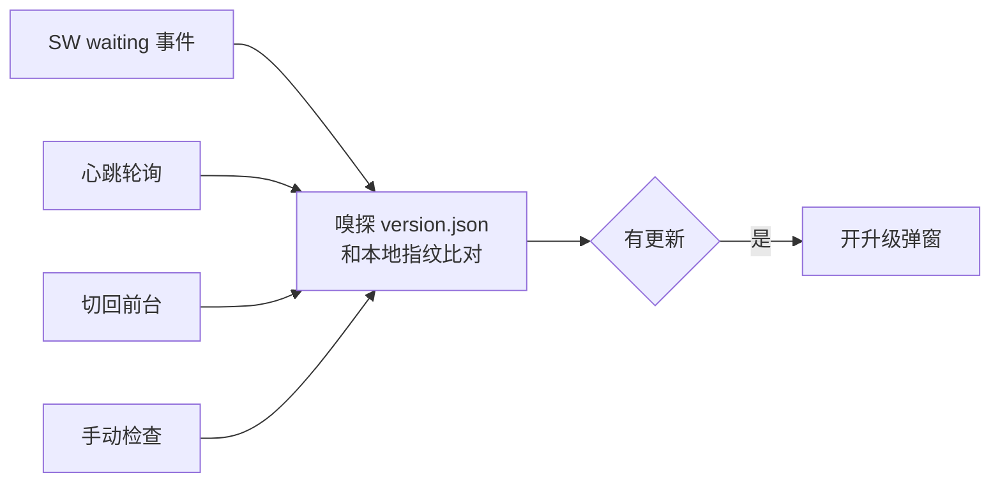

# 离线与升级

基准：v1.1.0 / 2026-11-11

这篇说明页面离线可用和新版本升级的机制。PWA 的构建插件、升级控制器和构建后门禁由 nexus-kit 提供（构建侧 `@nexus-kit/vite`，运行时侧 `@nexus-kit/pwa`）。文中提到的常量只写名字，数值以代码为准。

## 1. 组成

| 部分 | 代码 |
|---|---|
| PWA 配置唯一出处（应用名、缓存分区） | `pwa.config.ts` |
| 构建插件：manifest、Service Worker、version.json、指纹注入 | `vite.config.ts`，机制在 `@nexus-kit/vite` |
| 升级控制器：检测、弹窗时机、升级执行 | `src/pwa.ts`，机制在 `@nexus-kit/pwa` |
| 升级界面：弹窗、设置里的手动更新 | `src/ui/update.ts` |
| 构建后门禁：体积预算 | `scripts/verify-build.ts` |

## 2. 离线

Service Worker 预缓存全部构建产物（HTML、JS、CSS、字体、图标）。首次打开时 SW 把它们全部下载进 Cache Storage，之后没有网络也能打开页面。

产物文件名都带内容哈希，发布新版本时文件名随之变化，新旧两版的缓存互不干扰：旧页面用的还是旧文件，新页面用新文件。

## 3. 构建指纹

每次构建注入三个值（`src/build-info.ts` 只做声明，源码里没有可改的值）：

| 值 | 来源 |
|---|---|
| `APP_VERSION` | 产品版本，取自 `package.json`，带 v 前缀 |
| `APP_BUILD` | 构建序号，来自仓库根的 `.build-number` 计数器 |
| `APP_NOTES_DIGEST` | 本版更新说明的指纹 |

- 构建计数器每次构建原子递增（带锁，多进程同时构建不冲突）。它不入库，每台机器各自递增；CI 和新 clone 上缺失时从 0 建档并警告。
- 说明指纹在「同一个版本号重新发布」（比如补发事故修复）时用来判断更新说明变没变。

## 4. version.json 与更新说明

构建时从 `CHANGELOG.md` 解析已发版本的条目，生成 `dist/version.json`：

```json
{
  "version": "1.1.0",
  "build": 4,
  "releases": [
    { "version": "1.1.0", "date": "2026-11-11", "notes": ["…"] }
  ]
}
```

- 版本按 CHANGELOG 里的小节顺序排列，新的在前，最多带 `releasesMax` 个版本。
- 以「内部：」开头的条目只在 CHANGELOG 留档，不进 version.json，用户在升级弹窗里看不到。
- 升级弹窗展示的更新说明就是这里的 notes，来源是 CHANGELOG，两处不会不一致。

## 5. 更新检测

控制器合并四条检测路径，命中后去重：



| 路径 | 触发 |
|---|---|
| SW waiting | 浏览器发现新版 Service Worker 在等待激活 |
| 心跳轮询 | 每隔 `checkIntervalMs` 嗅探一次 version.json |
| 切回前台 | 页面从后台回到前台时嗅探 |
| 手动检查 | 设置里点「更新到最新版」 |

判定是本地指纹（版本 + 构建 + 说明指纹）和远端 version.json 比对，所以跨版本和同版本重发都能识别。网络失败静默，只记日志，不打扰用户。

## 6. 升级弹窗

红线：没有用户主动点击，页面绝不自动刷新。刷新只发生在用户点「立即更新」，或在设置里点「更新到最新版」之后——点击本身就是授权。

- 检测命中即弹窗，展示从本地版本到最新版本之间的全部更新说明；隔了几个版本时折叠成「更早的 N 个版本也会一起更新」，点开可看。
- 调音过程中 `setPromptBlocked(true)` 暂缓弹窗，停止调音后补开。
- 点「稍后」关窗，本次使用期间（`dismissTtlMs` 内）同一构建不再自动弹；出新版本或手动检查仍会提醒。
- 点「立即更新」：下载并激活新版 SW，然后刷新页面。下载或切换卡住时说明原因和处理办法。
- 升级完成的下一次打开，顶部短暂提示「已更新到 vX.Y.Z」。

## 7. 验证开关

地址加 `?nosw=1`：反注册 Service Worker、清空 Cache Storage、本轮不再注册。实机验收时拿到的永远是服务器上的最新构建。

## 8. 构建后门禁

`pnpm build` 的第二步（`scripts/verify-build.ts`）检查 `dist/`：

- manifest 的应用名正确，预缓存条目完整；
- 预缓存总量不超过 `precacheKB`；首屏关键路径（index.html 加入口 JS/CSS，压缩后）不超过 `criticalKB`。

预算超了先查原因，再决定要不要调数。

nexus-kit 内部的解析、指纹和升级状态机在 nexus-kit 仓库里有测试；本仓库的测试覆盖调音逻辑，见[音高检测](音高检测.md)§7。升级链路用上面的验证开关做实机验收。
