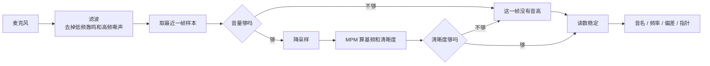
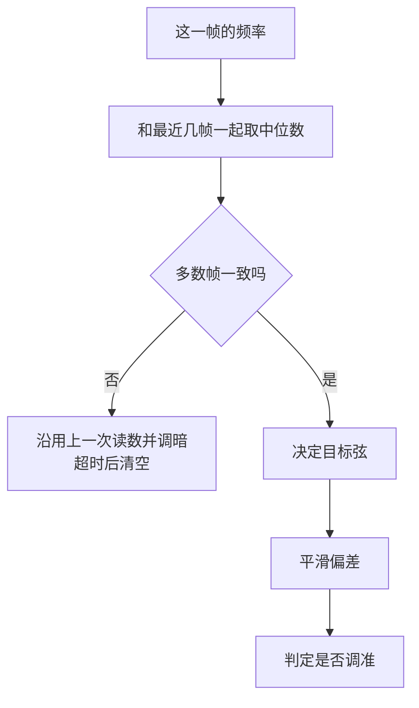

# 音高检测和读数稳定

基准：v1.0.0 / 2026-11-11

这篇说明琴声怎么变成屏幕上的读数。文中提到的常量只写名字，数值以代码为准。

## 1. 整体流程

| 步骤 | 代码 |
|---|---|
| 打开麦克风、滤波 | `src/audio/mic.ts` |
| 分帧、门限、降采样 | `src/audio/analyze.ts` |
| MPM 基频检测 | `src/audio/pitch.ts` |
| 读数稳定 | `src/tuner/tracker.ts` |
| 频率、音名、音分换算 | `src/tuner/notes.ts` |
| 界面刷新和指针动画 | `src/main.ts`、`src/ui/gauge.ts` |

所有计算都在浏览器主线程里完成，没有网络请求。

## 2. 采集

- 麦克风用 `getUserMedia` 打开，关闭降噪、回声消除和自动增益。
- 声音先过两个滤波器：高通滤掉手碰设备产生的低频轰鸣，低通滤掉嘶声和高次泛音。吉他六根弦的基频在 82 到 330 Hz 之间，都在保留的频段里。
- 用 `AnalyserNode` 取最近一帧的波形。一帧的长度是 `MIN_FRAME_SECONDS` 向上取到 2 的整数次幂个样本，保证最低的 E2 在一帧里有 6 个以上周期。
- 页面每隔 `ANALYSIS_INTERVAL_MS` 分析一次。相邻两帧大部分重叠，所以读数更新得比帧长快。

## 3. 每帧分析

`createAnalyzer` 对每一帧做三件事：

1. **音量门限**：均方根低于 `RMS_GATE` 的帧直接判为没有琴声。
2. **降采样**：把采样率降到不低于 `TARGET_SAMPLE_RATE`。吉他基频远低于这个采样率的一半，精度不受影响，计算量降到原来的几分之一。
3. **清晰度门限**：MPM 给出的清晰度低于 `CLARITY_GATE` 的帧判为噪声。说话声、环境噪声、两根弦同时响，清晰度都上不去。

## 4. 基频检测：MPM

MPM（McLeod Pitch Method）的思路：一个有固定音高的声音，把波形往后挪一个周期，会和原来的波形几乎重合。算法就是去找「挪多少才重合」。

1. **算相似度曲线**。对每一个挪动量 `lag`，算挪动后的波形和原波形有多像，得到一条曲线（NSDF，归一化平方差函数）。值是 1 表示完全重合，0 表示不相关，−1 表示正好相反。
2. **找候选峰**。跳过 `lag = 0` 附近的那一段（不挪当然重合），之后曲线每冒出零线以上一次，取其中最高的一点作为候选峰。
3. **选峰**。取第一个高度达到最高峰 `PEAK_RATIO` 倍的候选峰。挪一个周期能重合，挪两个、三个周期同样能重合，所以后面还有一串一样高的峰；必须选最靠前的那个，否则会把音认低一个八度。反过来，泛音很强时半个周期处也会冒出一个矮峰，`PEAK_RATIO` 把它挡在门外，避免把音认高一个八度。
4. **细化**。峰的位置只能落在整数采样点上。用峰和它左右两点拟合一条抛物线，取抛物线的顶点，得到带小数的周期。基频 = 采样率 ÷ 周期，清晰度 = 顶点的高度。

手机麦克风对 100 Hz 以下的声音不敏感，6 弦的基频可能很弱。MPM 看的是整个波形的重复周期，不是某个频率分量的强弱，只要泛音还在，周期就还在，所以仍然能认出基频。

## 5. 读数稳定

每帧的原始频率带着抖动，偶尔还有误检。`Tracker` 把它变成稳定的读数，输入是每帧的频率（或「没有音高」）和时间戳，输出是音名、目标弦、偏差和是否调准。

### 5.1 滤掉误检

保留最近 `WINDOW_SIZE` 帧的频率，取中位数。单独一帧的误检（比如拨弦瞬间认成了高八度）进不了中位数。

窗口里至少要有 `AGREE_COUNT` 帧和中位数相差不超过 `AGREE_CENTS` 音分才出读数。噪声偶尔会骗过清晰度门限，但每次骗出来的频率都不一样，凑不出一致的几帧。

### 5.2 决定目标弦

- 手动选弦时，目标弦就是选中的那根。
- 自动识别时，候选弦是离中位数频率音分距离最近的那根。
  - **重新拨弦**（静音超过 `GAP_RESET_MS` 之后的第一个稳定读数）：直接采用候选弦。
  - **声音没断时候选弦变了**：新弦要比当前目标弦近 `SWITCH_MARGIN_CENTS` 音分以上，并且连续出现 `SWITCH_FRAMES` 帧，才换过去。这样一根弦跑调到两根弦正中间时，目标弦不会来回跳。
  - 等待确认的那几帧沿用上一次读数。否则偏差是相对旧目标弦算的，会有几百音分，指针会先甩到端点再回来。

### 5.3 平滑偏差

偏差是中位数频率相对目标弦标准频率的音分数。

- 变化小的时候做指数平滑，时间常数是 `SMOOTH_MS`，压掉几个音分的抖动。
- 变化超过 `SNAP_CENTS` 时直接跳到新值。拧弦钮的时候偏差变化大，指针要马上跟上，不能拖尾。

屏幕上的指针在此基础上还有一层动画缓动（`NEEDLE_EASE_MS`），让两次分析之间的移动看起来连续。

### 5.4 判定调准

进入调准状态的门限是 `IN_TUNE_ENTER_CENTS`，退出的门限是 `IN_TUNE_EXIT_CENTS`。退出门限更宽，读数停在门限附近时不会在两种颜色之间闪烁。换了目标弦之后重新判定。

### 5.5 显示的音名

音名取离中位数频率最近的半音。已经显示了某个音名之后，频率要偏离它超过 `NOTE_SWITCH_CENTS` 音分才换，避免在两个半音的分界处来回跳。

### 5.6 信号消失

没有稳定读数时沿用上一次读数，并标记为「保留」，界面把它调暗。超过 `holdMs` 仍然没有新读数就清空全部状态。

## 6. 参考音

`src/audio/tone.ts` 用一个带泛音的振荡器合成参考音，音量像拨弦一样快速冲高再慢慢衰减。加泛音是因为手机扬声器放不出 E2 这么低的基频，靠泛音才能听出音高。

参考音播放期间以及结束后的 `TONE_TAIL_MS` 内不做音高分析，避免调音器听到自己的声音后显示「调准了」。

## 7. 测试

| 测试文件 | 覆盖内容 |
|---|---|
| `src/audio/pitch.test.ts` | 各采样率下六根弦的精度、强泛音、弱基频、带噪声、纯噪声、静音、超出范围 |
| `src/audio/analyze.test.ts` | 帧长选择、各采样率下的端到端精度、音量门限、噪声 |
| `src/tuner/tracker.test.ts` | 出读数的条件、误检过滤、换弦、防跳弦、平滑、保留和清空、调准判定、手动选弦、基准频率 |
| `src/tuner/notes.test.ts` | 频率、音名、音分换算，最近的弦 |
| `src/settings.test.ts` | 设置的读取、校验和默认值 |

运行：`npm test`
